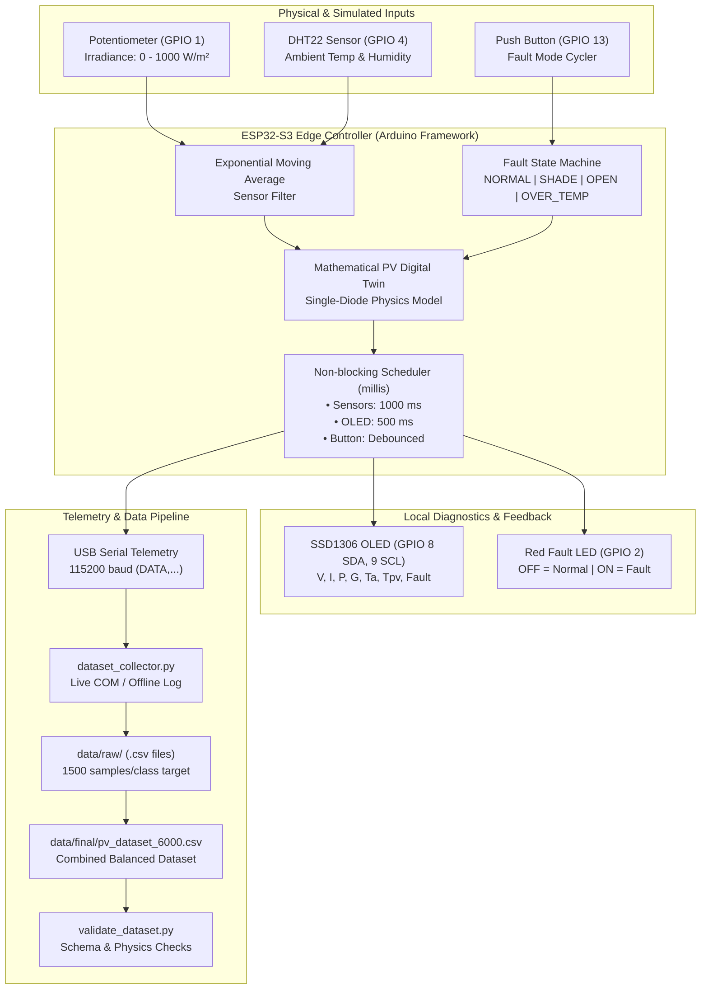
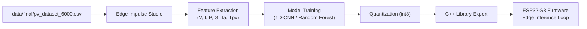

# PV Fault Diagnosis Without Thermal Camera Using Mathematical PV Modeling and TinyML

[](https://www.espressif.com/)
[](https://www.arduino.cc/)
[](https://platformio.org/)
[](https://wokwi.com/projects/474574564546576385)
[](#current-implementation-status)

---

## 1. Project Overview & Motivation

Solar Photovoltaic (PV) power systems require continuous condition monitoring to ensure high operating efficiency, fire prevention, and early detection of array anomalies. Conventional fault detection in PV arrays relies heavily on **aerial thermal infrared cameras (drones)**, handheld infrared imagers, or high-end pyranometer instrumentation. 

While thermal imaging provides direct spatial visualization of hotspots and diode failures, it suffers from severe limitations:
- **Prohibitive capital and operational expense** (high camera cost, drone pilots, recurring inspection flights).
- **Intermittent inspection intervals** (faults developing between quarterly or annual inspections remain undetected for months).
- **Susceptibility to environmental conditions** (wind cooling, solar reflection, cloud transients distort thermal signatures).

This project demonstrates that **PV fault diagnosis can be accomplished without thermal cameras** by combining:
1. **Low-cost IoT edge sensing**: Irradiance estimation via potentiometer, ambient temperature, and relative humidity via DHT22.
2. **On-chip deterministic PV mathematical modeling**: Running a single-diode physics digital twin on an **Espressif ESP32-S3** microcontroller.
3. **Embedded TinyML inference**: Classifying complex multi-variable operating signatures on-device with sub-millisecond latency.

---

## 2. Problem Statement & Objectives

### Problem Statement
How can a resource-constrained edge microcontroller accurately diagnose PV array faults (such as partial shading, circuit disconnection, and thermal stress) in real time using only standard electrical ($V, I$) and environmental ($G, T_a, H$) telemetry without visual or thermal imaging sensors?

### Objectives
- **Develop an embedded digital twin** on an ESP32-S3 microcontroller running Arduino framework to model healthy and faulted PV electrical states.
- **Implement four distinct operating conditions**: `NORMAL`, `PARTIAL_SHADE`, `OPEN_CIRCUIT`, and `OVER_TEMP`.
- **Provide rich local diagnostics**: Visual telemetry via a 128x64 SSD1306 OLED display, status indication via a fault LED, and mode selection via a hardware push button.
- **Deliver structured data telemetry**: Emit machine-readable CSV records (`DATA,` prefix) over USB Serial at 1 Hz for ML training and dataset curation.
- **Build an automated Python data collection and validation suite**: Support live serial logging and offline Wokwi simulation ingestion with schema and power-consistency validation.
- **Prepare the dataset for TinyML pipeline**: Format feature sets for Edge Impulse training, quantization, and C++ library export back into the ESP32-S3 firmware.

---

## 3. System Architecture & Data Flow



---

## 4. Hardware Components & GPIO Connections

The physical and simulated prototype is designed for an **Espressif ESP32-S3 DevKitC-1** microcontroller (240 MHz dual-core Xtensa LX7, 320 KB SRAM, 8 MB Flash).

### Pin Mapping Table

| Component | Pin Number | Interface / Signal | Configuration & Details |
| :--- | :--- | :--- | :--- |
| **Rotary Potentiometer** | `GPIO 1` | Analog Input (`SIG`) | Irradiance $G$ ($0 - 1000\text{ W/m}^2$), 12-bit ADC (`0 - 4095`), EMA filtered |
| **Fault Indicator LED** | `GPIO 2` | Digital Output (`ANODE`) | Active `HIGH` through 220 $\Omega$ current-limiting resistor to GND |
| **DHT22 Weather Sensor** | `GPIO 4` | One-Wire Digital (`DATA`) | Ambient Temperature ($T_a$) & Relative Humidity ($H$) |
| **SSD1306 OLED (SDA)** | `GPIO 8` | I2C Serial Data (`SDA`) | Hardware I2C bus at address `0x3C` |
| **SSD1306 OLED (SCL)** | `GPIO 9` | I2C Serial Clock (`SCL`) | Hardware I2C bus (400 kHz) |
| **Fault Mode Button** | `GPIO 13` | Digital Input (`1.l`) | Push-button to GND, `INPUT_PULLUP`, 50 ms software debouncing |
| **Common Power Rail** | `3V3` | Power Supply | 3.3V DC rail powering Potentiometer, DHT22, and OLED |
| **Common Ground** | `GND` | Ground Reference | Shared common ground for all peripherals |

---

## 5. PV Mathematical Model & Fault Modes

### 5.1 Standard Test Conditions (STC) Baseline
The digital twin calculates healthy baseline PV parameters relative to reference STC values ($G_{ref} = 1000\text{ W/m}^2$, $T_{ref} = 25^\circ\text{C}$):
- Maximum Power Point Voltage: $V_{mp,ref} = 18.0\text{ V}$
- Maximum Power Point Current: $I_{mp,ref} = 2.7\text{ A}$
- Open-Circuit Voltage: $V_{oc,ref} = 21.6\text{ V}$
- Voltage Temperature Coefficient: $\beta_V = -0.004\text{ /}^\circ\text{C}$

### 5.2 Governing Equations

1. **PV Cell Temperature Estimation ($T_{pv}$)**:
   $$T_{pv} = T_a + \left(\frac{G}{G_{ref}}\right) \times 3.0^\circ\text{C}$$

2. **Photocurrent Generation ($I$)**:
   $$I(G) = I_{mp,ref} \times \left(\frac{G}{G_{ref}}\right)$$

3. **Terminal Voltage ($V$) with Thermal Derating**:
   $$V(T_{pv}) = V_{mp,ref} \times \left[1 + \beta_V \times (T_{pv} - T_{ref})\right]$$
   *(For low-light conditions $G < 40\text{ W/m}^2$, voltage scales down smoothly: $V \leftarrow V \times \frac{G}{40}$)*

4. **Array Output Power ($P$)**:
   $$P = V \times I$$

---

### 5.3 Fault Mode Definitions

| Mode ID | Fault State | Physical Cause | Electrical Behavior | LED | OLED Status Line |
| :---: | :--- | :--- | :--- | :---: | :--- |
| `0` | **`NORMAL`** | Pristine module operating in uniform sunlight | $I = I_{normal}$, $V = V_{normal}$, nominal power | **OFF** | `FAULT: NORMAL` |
| `1` | **`PARTIAL_SHADE`** | Soiling, bird droppings, cloud shadows | $I \leftarrow I \times 0.45$, $V \leftarrow V \times 0.95$, $P$ drops $\approx 55\%$ | **ON** | `FAULT: PARTIAL_SHADE` |
| `2` | **`OPEN_CIRCUIT`** | Disconnected cable, blown DC fuse, loose plug | $I = 0.00\text{ A}$, $V \approx V_{oc} \approx 21.6\text{ V}$, $P = 0.00\text{ W}$ | **ON** | `FAULT: OPEN_CIRCUIT` |
| `3` | **`OVER_TEMP`** | Thermal hotspot, poor ventilation, heat-sink blockage | $T_{pv} \leftarrow T_a + 35^\circ\text{C}$, $V$ drops severely ($12 - 14\text{ V}$), $I \leftarrow I \times 0.95$ | **ON** | `FAULT: OVER_TEMP` |

---

## 6. Local User Interface & Actuators

- **Rotary Potentiometer (GPIO 1)**: User controls simulated solar irradiance in real time from $0$ to $1000\text{ W/m}^2$.
- **Push Button (GPIO 13)**: Advances the operational state machine on each click (`NORMAL` $\rightarrow$ `PARTIAL_SHADE` $\rightarrow$ `OPEN_CIRCUIT` $\rightarrow$ `OVER_TEMP` $\rightarrow$ repeat).
- **Red Fault LED (GPIO 2)**: Extinguished when the array is operating under healthy `NORMAL` conditions; illuminated continuously whenever any fault mode is active.
- **SSD1306 OLED (128x64)**: Refreshed every 500 ms without blocking the main telemetry loop. Displays:
  ```text
  +----------------------------------+
  | PV FAULT DIAGNOSIS               |
  |----------------------------------|
  | G:  750 W/m2    H: 52%           |
  | Ta: 28.5 C      Tpv: 30.8 C      |
  | V:  17.58 V     I:  2.03 A       |
  | P:  35.69 W                      |
  |----------------------------------|
  | FAULT: NORMAL                    |
  +----------------------------------+
  ```

---

## 7. Wokwi Simulation Setup

The project can be executed either directly in **Visual Studio Code** or in a **web browser on Wokwi.com**.

### Option A: Online on Wokwi.com (Zero Setup)
1. Navigate directly to the public project:
   👉 **[https://wokwi.com/projects/474574564546576385](https://wokwi.com/projects/474574564546576385)**
2. Click **Start the Simulation** ▶.
3. Interact with the potentiometer, adjust the DHT22 sliders, and click the blue push button to cycle fault states.

### Option B: In Visual Studio Code (Local Extension)
1. Install the official **Wokwi Simulator** extension from the VS Code Marketplace.
2. Open this repository in VS Code.
3. Open [`diagram.json`](diagram.json).
4. Press <kbd>F1</kbd> and select **`Wokwi: Start Simulator`** (or click the green Play ▶ button).
5. The extension reads [`wokwi.toml`](wokwi.toml) and boots the compiled firmware binary (`.pio/build/esp32-s3-devkitc-1/firmware.bin`).

---

## 8. Software Environment & Dependencies

### Embedded Firmware
- **PlatformIO Core** $\ge 6.2.0$ (or Arduino IDE $\ge 2.0$)
- Platform: `espressif32 @ ^7.1.2`
- Framework: `arduino`
- Board: `esp32-s3-devkitc-1`
- Libraries (`platformio.ini` & `libraries.txt`):
  - `adafruit/Adafruit GFX Library @ ^1.11.5`
  - `adafruit/Adafruit SSD1306 @ ^2.5.7`
  - `beegee-tokyo/DHT sensor library for ESPx @ ^1.19`

### Python Environment
Install the dataset collection dependencies:
```bash
pip install -r collector/requirements.txt
```
*(For offline log ingestion, Python standard library is sufficient; `pyserial>=3.5` is required for live USB-serial capture).*

To run the offline exploratory plotting scripts in [`python/`](python/):
```bash
pip install pandas numpy matplotlib
```

---

## 9. Dataset Collection Workflow

Telemetry is broadcast over Serial at **115200 baud** using a clean, comma-delimited format:
```text
DATA,timestamp_ms,irradiance_wm2,humidity_percent,ambient_temp_c,pv_temp_c,voltage_v,current_a,power_w,fault_mode
DATA,14000,750,52.0,28.5,30.8,17.58,2.03,35.69,NORMAL
```

### Method 1: Offline Log Ingestion (Recommended for Wokwi)
1. Run the simulation in Wokwi (VS Code or browser).
2. Adjust environmental controls and cycle through all four fault states.
3. Copy the serial monitor text and save it to a file, e.g., `wokwi_log.txt`.
4. Run the collector:
   ```bash
   python collector/dataset_collector.py --input wokwi_log.txt
   ```
5. The collector parses records, rejects non-telemetry lines, tallies valid rows into `data/raw/*.csv`, and automatically compiles the combined dataset once 1,500 samples per class are reached.

### Method 2: Live Hardware Serial Collection
Connect a physical ESP32-S3 over USB and run:
```bash
python collector/dataset_collector.py --port COM3 --baud 115200
```
*(On Linux/macOS, use `--port /dev/ttyUSB0` or `--port /dev/ttyACM0`).*

---

## 10. Dataset Validation Commands

To validate an existing or newly generated dataset against schema, row count, null values, and electrical consistency ($|V \times I - P| \le 0.5\text{ W}$):

### Validate Baseline 1,000-Sample Dataset
```bash
python collector/validate_dataset.py --dataset data/pv_dataset.csv --target 250
```

**Validation Output:**
```text
DATASET VALIDATION
==================
File: data/pv_dataset.csv
Total samples: 1000 (Expected: 1000)

NORMAL          :  250 / 250 [PASS]
PARTIAL_SHADE   :  250 / 250 [PASS]
OPEN_CIRCUIT    :  250 / 250 [PASS]
OVER_TEMP       :  250 / 250 [PASS]

Missing values:     0 [PASS]
Malformed rows:     0 [PASS]
Inconsistent Power: 0 [PASS] (Where P != V*I)

Dataset status: VALID
```

### Validate Target 6,000-Sample Dataset
```bash
python collector/validate_dataset.py
```
*(Defaults to checking `data/final/pv_dataset_6000.csv` with 1,500 samples per class).*

---

## 11. Current Implementation Status

| Milestone / Component | Status | Verification & Evidence |
| :--- | :---: | :--- |
| **ESP32-S3 Arduino Firmware** | **Completed** | Clean compilation via PlatformIO (`RAM: 6.1%`, `Flash: 9.5%`) |
| **Wokwi Circuit & Simulation** | **Completed** | Full wiring defined in [`diagram.json`](diagram.json), live at [Wokwi.com](https://wokwi.com/projects/474574564546576385) |
| **Deterministic PV Model Twin** | **Completed** | Implemented in [`sketch.ino`](sketch.ino) and tested across all 4 modes |
| **OLED Dashboard & Status LED** | **Completed** | SSD1306 128x64 display + Active-HIGH fault indicator on GPIO 2 |
| **Serial Telemetry Stream** | **Completed** | 1 Hz non-blocking `DATA,` CSV formatted output |
| **Dataset Collector Pipeline** | **Completed** | [`collector/dataset_collector.py`](collector/dataset_collector.py) supporting live COM & offline log parsing |
| **Dataset Validator Tool** | **Completed** | [`collector/validate_dataset.py`](collector/validate_dataset.py) verified on baseline dataset |
| **Baseline 1,000-Sample Dataset** | **Completed** | Preserved in [`data/pv_dataset.csv`](data/pv_dataset.csv) (250 samples per class) |
| **Raw Ingestion Directories** | **Completed** | Initialized templates in [`data/raw/`](data/raw/) |
| **Target 6,000-Sample Collection** | *In Progress* | Pipeline ready; awaiting completion of live/offline sample collection |
| **Edge Impulse Model Training** | *Planned* | Feature extraction block and classifier architecture planned |
| **On-Device TinyML Deployment** | *Planned* | Quantized C++ model deployment back to ESP32-S3 firmware planned |

---

## 12. Planned Edge Impulse Training & TinyML Roadmap

The next phase of this research is the transition from telemetry generation to autonomous on-device inference:



1. **Dataset Ingestion**: Upload the balanced 6,000-sample dataset to [Edge Impulse Studio](https://edgeimpulse.com/).
2. **Impulse Design**:
   - Time-series or tabular block with windowing (window size: 1000 ms, sliding stride: 1000 ms).
   - Input features: `irradiance_wm2`, `humidity_percent`, `ambient_temp_c`, `pv_temp_c`, `voltage_v`, `current_a`, `power_w`.
3. **Model Exploration**:
   - Evaluate a lightweight **Dense Neural Network / 1D-CNN** vs. an embedded **Random Forest / Decision Tree Classifier**.
4. **Optimization & Quantization**:
   - Quantize weights to `int8` using TensorFlow Lite for Microcontrollers (TFLM).
5. **Edge Deployment**:
   - Export the trained model as an optimized Arduino C++ library and integrate directly into `sketch.ino` to replace manual button fault cycling with real-time autonomous edge diagnosis.

---

## 13. Known Limitations & Future Work

### Known Limitations
- **Simulation Environment**: Sensor inputs are currently driven by potentiometer (ADC) and DHT22 digital models rather than physical PV string arrays.
- **Single-Diode Approximation**: The mathematical model uses a deterministic single-diode STC derivation; it does not model complex double-diode shunt currents or severe multi-string bypass diode distortion.
- **Dataset Size**: Currently, the repository includes the verified baseline 1,000-sample dataset (`data/pv_dataset.csv`). The full 6,000-sample dataset will be populated as collection completes.

### Future Work
- Deploy the ESP32-S3 firmware onto physical PV strings with an INA226/INA219 DC voltage/current sensor and MAX6675 thermocouple.
- Incorporate dust/soiling accumulation estimation models based on ambient humidity and time-of-flight dust sensors.
- Integrate LoRaWAN or ESP-NOW mesh telemetry for multi-string commercial rooftop installations.

---

## 14. Repository Structure

```text
PV_Fault_Diagnosis_TinyML/
├── .gitignore                      # Git exclusion rules (.pio, cache, logs, secrets)
├── platformio.ini                  # PlatformIO project configuration & ESP32-S3 dependencies
├── diagram.json                    # Wokwi simulation circuit layout and wiring
├── wokwi.toml                      # Wokwi VS Code extension configuration
├── libraries.txt                   # Wokwi web simulator library declarations
├── sketch.ino                      # Arduino C++ digital twin & telemetry firmware (Wokwi entry)
│
├── src/
│   └── sketch.ino                  # PlatformIO compilation entry point
│
├── wokwi/
│   ├── diagram.json                # Standalone Wokwi circuit definition
│   └── sketch.ino                  # Standalone Wokwi firmware copy
│
├── collector/
│   ├── dataset_collector.py        # Automated live & offline dataset collection pipeline
│   ├── validate_dataset.py         # Dataset schema and physical model validation tool
│   └── requirements.txt            # Python dependencies (pyserial>=3.5)
│
├── data/
│   ├── pv_dataset.csv              # Baseline 1,000-sample balanced dataset (250/class)
│   ├── README.md                   # Feature dictionary & column descriptions
│   ├── raw/                        # Ingestion targets (normal, shade, open, over_temp)
│   └── final/                      # Target directory for combined 6,000-sample dataset
│
├── python/
│   ├── collect_serial.py           # Serial telemetry ingestion utility
│   ├── generate_dataset.py         # Synthetic mathematical model generator
│   └── analyze_dataset.py          # Data analysis, statistics, and figure generation
│
├── results/
│   ├── plots/                      # High-resolution I-V, P-V, and boxplot figures
│   │   ├── fault_distributions.png
│   │   └── iv_pv_curves.png
│   └── tables/                     # Markdown and CSV statistical summaries
│       ├── fault_class_summary.csv
│       └── fault_class_summary.md
│
├── docs/                           # Technical documentation & research specifications
│   ├── DATA_COLLECTION.md          # Data collection workflow manual
│   ├── FAULT_MODEL.md              # Fault injection equations & physical models
│   ├── PROJECT_README.md           # Research abstract and motivation
│   ├── prototype_architecture.md   # Architectural block diagram
│   ├── PV_MODEL.md                 # Single-diode PV model mathematical derivation
│   └── SYSTEM_ARCHITECTURE.md      # Pinout table and software scheduling
│
└── README.md                       # Master project documentation
```

---

## 15. Authors & Acknowledgments

- **Project**: PV Fault Diagnosis Without Thermal Camera Using Mathematical PV Modeling and TinyML
- **Platform**: Espressif ESP32-S3 | Arduino Framework | Wokwi | Edge Impulse
- **Simulation**: [Wokwi Project 474574564546576385](https://wokwi.com/projects/474574564546576385)
